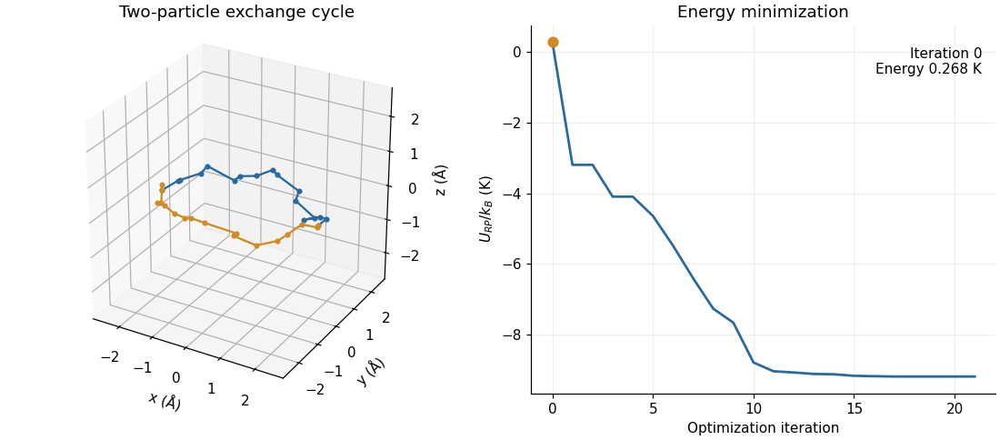

# JAX-Landscape

General-purpose energy-landscape analysis in JAX. Define a differentiable energy
function to minimize configurations, detect and escape saddle points, and analyze
Hessian eigenvalues and eigenvectors.

- Local optimization through SciPy with automatic gradients and Hessian-vector products.
- Dense Hessian analysis and negative-curvature saddle escape.
- Ring-polymer energies and worldline I/O for path-integral systems with particle exchange.

## Example: helium exchange cycle



Minimization of a helium exchange cycle with 16 imaginary-time slices per particle.
The animation shows the worldline geometry and energy over successive optimization
iterations. [Example parameters and results](docs/validation.md#two-particle-exchange-example).

## Installation

Requires Python 3.11–3.13 and [uv](https://docs.astral.sh/uv/).
Verified on macOS with Python 3.11 and the JAX CPU backend.

```sh
git clone https://github.com/nbzy1995/jax-landscapes.git
cd jax-landscapes
uv sync --python 3.11 --frozen --extra dev --extra demo
```

The reproducible environment uses JAX 0.4.38 and a pinned JAX-MD fork.
[Dependency details](docs/validation.md#dependencies).

## Quick start

The optimization API accepts a JAX-compatible energy function of the coordinates.
This example uses the supplied Aziz helium pair potential:

```python
import jax
import jax.numpy as jnp
from jax_md import space
from jax_landscape.energy_fun import build_energy_fn_aziz_1995_no_neighborlist
from jax_landscape.local_minima import find_local_minimum
from jax_landscape.hessian_eigenvals import compute_hessian_eigenvalues

jax.config.update("jax_enable_x64", True)
displacement, _ = space.free()
energy = jax.jit(build_energy_fn_aziz_1995_no_neighborlist(displacement))
positions = jnp.array([[0., 0., 0.], [3.5, 0., 0.]])
result = find_local_minimum(energy, positions, gtol=1e-6)
spectrum = compute_hessian_eigenvalues(energy, result["xyz_final"])
print(result["energy_final"], spectrum["eigenvalues"])
```

Run the exchange-cycle example:

```sh
uv run --frozen python example/helium_exchange.py
```

The script writes an animation, convergence plot, trajectory and numerical results
to `.scratch/helium-exchange/`.

## Validation

| Component | Checks |
|---|---|
| Pair energies and gradients | 6- and 500-particle reference fixtures; direct and neighbor-list agreement |
| Hessians | Analytical harmonic solution, finite differences and eigenpair reconstruction |
| Path-integral energies | Free-particle cases and stored OpenMM reference values |
| Minimization | Stationarity, local stability and Hessian checks |

[Validation details and test status](docs/validation.md#current-test-status).

An [archived 64-particle OpenMM comparison](docs/openmm-comparison.txt) reports
agreement in initial and final energies and a final coordinate RMSD of 0.0005 Å.

```sh
uv run --frozen python -m pytest tests
```

## Numerical considerations

Enable JAX float64 for derivative and curvature calculations. Dense Hessian
analysis requires quadratic storage in the number of coordinates. Molecular
minimization uses direct pair calculations: a fixed neighbor list can become
invalid as coordinates move.

## References

- R. A. Aziz, A. R. Janzen and M. R. Moldover. [Ab Initio Calculations for Helium: A Standard for Transport Property Measurements](https://doi.org/10.1103/PhysRevLett.74.1586), 1995.
- D. M. Ceperley. [Path integrals in the theory of condensed helium](https://doi.org/10.1103/RevModPhys.67.279), 1995.
- [JAX](https://github.com/jax-ml/jax) · [JAX-MD](https://github.com/jax-md/jax-md) · [SciPy](https://scipy.org/)

## License

Original code and research assets are licensed under
[Creative Commons Attribution–NonCommercial 4.0 International](LICENSE).
Third-party code, dependencies and materials retain their original licenses.
